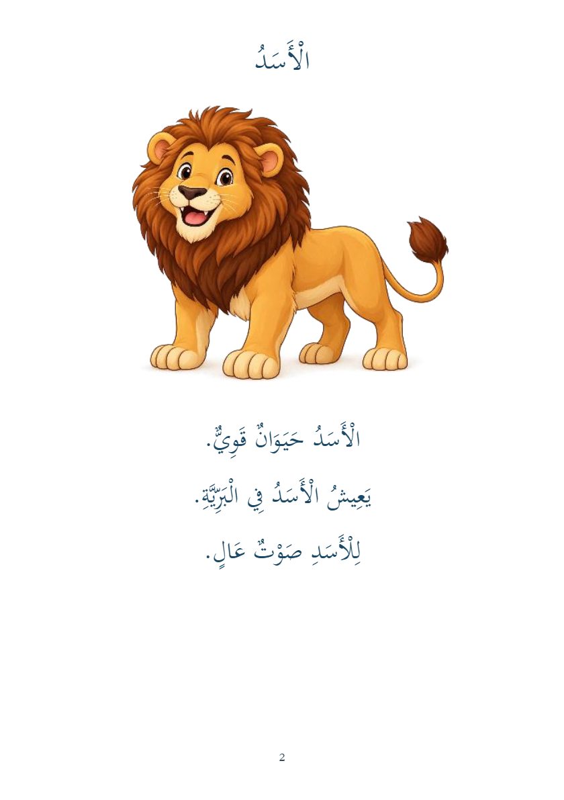

<div dir="rtl" align="right">

# كتاب القصص البسيطة



نسخة مبسّطة من `Arabic_Stories_Workbook`: **28 قصة قصيرة**، كل قصة عنوانه كلمة مشكولة
وثلاث جمل بسيطة مشكولة، وصورة توضيحية من `Arabic_Alphabet_Workbook/assets/images`.
الكتاب يُبنى بصيغة **DOCX** بمقاس A5 واتجاه من اليمين لليسار، ثم يُحوَّل إلى PDF
عبر Microsoft Word ويُدمج مع بقية الكتب في `Arabic_Workbooks_Complete.pdf`.

> مصدر النصوص: `temp\stories-simple.docx` (لا يُنسخ داخل المشروع لأنه كبير؛
> يحتوي الصور مضمَّنة). تم استخراج الجمل كما هي، مع تصحيح خطأين مطبعيين:
> «مِنَ اشكال» ← «مِنْ أَشْكَالِ» في قصة الهلال، و«الرِّجْلُ» ← «الرَّجُلُ» في قصة الرجل.

## ترتيب الصفحات

| العنصر | العدد |
|--------|-------|
| غلاف كامل الصفحة (`assets/coverpage.png`، نسخة من غلاف كتاب القصص) | 1 |
| صفحة العنوان | 1 |
| صفحة لكل قصة (العنوان + الصورة + 3 جمل) | 28 |
| **المجموع** | **30 صفحة** |

## التنسيق

- الصورة في وسط الصفحة **بلا إطار**، محتواة في صندوق 3:2 بعرض 112 مم.
- عنوان القصة 28pt، والجمل 24pt (تباعد أسطر `AT_LEAST` 28pt)، وصفحة العنوان
  56pt والسطر الوصفي 28pt — مثل كتاب القصص الأصلي تماماً.

## البنية

```
Arabic_Simple_Stories_Workbook/
├── create-workbook.js        # يبني DOCX من assets فقط
├── extract-from-source.js    # يستخرج النصوص من ../temp/stories-simple.docx
├── package.json
├── Arabic_Simple_Stories_Workbook.docx   # ناتج البناء
└── assets/
    ├── stories.json          # الفهرس: id / letter / word / title / text / image
    ├── texts/NN-slug.txt     # السطر 1 = العنوان، ثم الجمل الثلاث
    ├── images/NN-slug.svg    # نفس صور Arabic_Alphabet_Workbook/assets/images
    └── coverpage.png
```

## الاستخراج والبناء

```bat
node extract-from-source.js                     # القراءة من ../temp/stories-simple.docx
node extract-from-source.js --source=..\temp\ملف-آخر.docx
node create-workbook.js                         # -> Arabic_Simple_Stories_Workbook.docx
```

أو من جذر المكتبة: `build-all.bat` (يبني الكتب الثمانية، يحوّلها إلى PDF ويدمجها).

الصور تُخزَّن كملفات SVG وتُحوَّل إلى PNG عند البناء عبر `svg2img` (الاعتمادية
نفسها التي يستخدمها `Arabic_Alphabet_Workbook`)؛ لا تُكتب ملفات الصور الوسيطة
إلى القرص. `extract-from-source.js` يعيد نسخ الـ28 SVG من مشروع الحروف عند كل
تشغيل، ويحتفظ بملفات النصوص المعدَّلة يدوياً إذا كانت جملها مطابقة للمصدر.

## ملاحظات

- الترتيب الافتراضي أبجدي (أ … غ)؛ `--order=alphabetical` يطبّق الترتيب المعجمي
  في الذاكرة فقط دون تعديل ملفات `assets`.
- `--no-page-numbers` يخفي أرقام الصفحات، و`--out=<dir>` يغيّر مجلد المخرجات.
- الاتجاه RTL مضبوط عبر `rtlDocumentDefaults()` من `scripts/rtl.js`؛
  و`node scripts\check-rtl.js` يتحقق من كل الكتب بعد البناء.
- الغلاف الحالي هو نسخة من `Arabic_Stories_Workbook/assets/coverpage.png`؛
  يمكن استبداله بصورة أخرى بالاسم نفسه.

</div>
